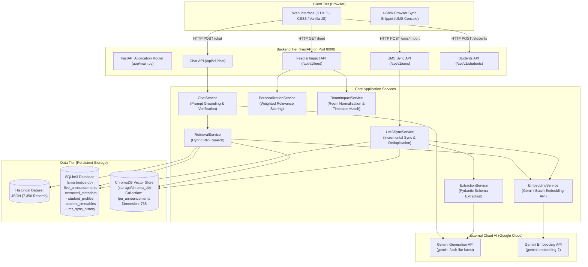

# 🎓 LPU SmartNotice — Master Viva Preparation Guide
**Project Title:** LPU SmartNotice — AI-Powered Personalized University Announcement Assistant  
**Domain:** Artificial Intelligence, Natural Language Processing, Retrieval-Augmented Generation (RAG), Web Engineering  
**Tech Stack:** Python 3.11, FastAPI, Google Gemini API (`gemini-flash-lite-latest`), Gemini Embedding API (`gemini-embedding-2`), ChromaDB, SQLite3, Vanilla JavaScript / HTML5 / CSS3  

---

## 📋 Table of Contents
1. [Executive Project Summary & Real-World Problem](#1-executive-project-summary)
2. [Component Implementation Verification Matrix](#2-component-implementation-verification-matrix)
3. [Ready-to-Speak Introductions (30s, 60s, 2 min)](#3-ready-to-speak-introductions)
4. [Complete System Architecture & Data Flow](#4-complete-system-architecture--data-flow)
5. [End-to-End Workflow & Lifecycle of an Announcement](#5-end-to-end-workflow--lifecycle-of-an-announcement)
6. [RAG (Retrieval-Augmented Generation) Deep Dive](#6-rag-retrieval-augmented-generation-deep-dive)
7. [AI & Information Extraction Pipeline](#7-ai--information-extraction-pipeline)
8. [Personalization & Scoring Formula](#8-personalization--scoring-formula)
9. [Room and Timetable Conflict Impact Analysis](#9-room-and-timetable-conflict-impact-analysis)
10. [Attachment-Aware Incomplete Evidence Handling](#10-attachment-aware-incomplete-evidence-handling)
11. [Storage Architecture: JSON vs SQLite vs ChromaDB](#11-storage-architecture-json-vs-sqlite-vs-chromadb)
12. [Complete Source Code Walkthrough](#12-complete-source-code-walkthrough)
13. [API Endpoints Reference Table](#13-api-endpoints-reference-table)
14. [Technology Trade-offs & Comparisons](#14-technology-trade-offs--comparisons)
15. [Security, Limitations & Professional Defense](#15-security-limitations--professional-defense)
16. [Testing, Metrics & Quantitative Evaluation](#16-testing-metrics--quantitative-evaluation)
17. [Case Study: Accommodation Deadline Retrieval Failure & Fix](#17-case-study-accommodation-deadline-retrieval-failure--fix)

---

## 1. Executive Project Summary

### What is LPU SmartNotice?
LPU SmartNotice is an intelligent web application and Retrieval-Augmented Generation (RAG) assistant designed for university students. It ingests thousands of university notices, structures them using AI, filters them based on individual student profiles (year, program, interests, timetable), and enables students to ask natural language questions grounded strictly in official university announcements with verifiable source citations.

### The Real-World Problem
At a mega-university like Lovely Professional University (with 35,000+ students and dozens of departments), over **7,000+ official announcements** are published annually on UMS (University Management System).
- **Information Overload:** Students receive hundreds of notices ranging from PhD defense invitations to placement drives for mechanical engineers, making it easy to miss crucial notices (e.g., fee deadlines, room relocations, scholarship forms).
- **One-Size-Fits-All Noticeboards:** A 1st-year student sees final-year placement notices; a CSE student sees Biotechnology lab rescheduling.
- **Search Inefficacy:** Standard university portals only support basic substring search on titles. Searching for *"When is the hostel address verification due?"* fails if the notice is titled *"MANDATORY VERIFICATION- Student PG/Residential Address Details"*.
- **LLM Hallucination Risk:** Asking a generic AI like ChatGPT or Gemini without RAG produces made-up dates, wrong room numbers, or guesses based on other universities because generic models do not have access to LPU's private, daily updated internal notices.

### Real-World Analogy
Think of the traditional university portal as a **giant physical notice board in the university square with 7,000 sheets of paper pinned to it**, updated every hour.
- Currently, a student has to stand in front of that board and read every single paper just to find out if Room 34-105 is closed today.
- **SmartNotice acts as a personal academic advisor** standing by the board. The advisor knows who you are (Year 3 B.Tech CSE), hands you only the notices that impact your courses and career, and when you ask, *"Where should I go for my 2 PM class?"*, the advisor points to the exact official notice number and tells you the room change.

---

## 2. Component Implementation Verification Matrix

| Component | Actual Implementation Status | Source File | Verified Behavior / Evidence |
|---|---|---|---|
| **FastAPI REST Backend** | **IMPLEMENTED AND VERIFIED** | `app/main.py` | Runs on Uvicorn, port 8000; provides CORS, health check, background startup sync. |
| **Historical Dataset Ingestion** | **IMPLEMENTED AND VERIFIED** | `app/services/dataset_service.py` | Loads 7,350 JSON records, validates IDs, hashes content, caches in memory. |
| **SQLite Persistence** | **IMPLEMENTED AND VERIFIED** | `app/core/database.py` | Tables `live_announcements`, `extracted_metadata`, `student_profiles`, `student_timetables`, `ums_sync_history`. |
| **ChromaDB Vector Store** | **IMPLEMENTED AND VERIFIED** | `app/services/vector_store_service.py` | Collection `lpu_announcements` with 400 indexed document vectors (768-dim). |
| **Gemini Batch Embeddings** | **IMPLEMENTED AND VERIFIED** | `app/services/embedding_service.py` | Uses `gemini-embedding-2`, wraps `types.Content` for batch embedding; offline fallback. |
| **Structured Metadata Extraction** | **IMPLEMENTED AND VERIFIED** | `app/services/extraction_service.py` | Uses Pydantic schema + Gemini; SQLite cache; heuristic fallback when offline. |
| **Hybrid Lexical + Vector Retrieval** | **IMPLEMENTED AND VERIFIED** | `app/services/retrieval_service.py` | Reciprocal Rank Fusion (RRF), concept clusters, room/block boosters, typo correction. |
| **RAG Answer Generation** | **IMPLEMENTED AND VERIFIED** | `app/services/chat_service.py` | Grounded prompt, strict temporal date checks, source citations, multi-model auto-failover. |
| **Personalized Feed Ranking** | **IMPLEMENTED AND VERIFIED** | `app/services/personalization_service.py` | Deterministic weighted scoring formula (Year 0.25, Dept 0.20, Interest 0.25, Urgency 0.15, Global 0.15). |
| **Room & Timetable Impact** | **IMPLEMENTED AND VERIFIED** | `app/services/room_impact_service.py` | Room regex normalization (`34-105`, `34304X`), range expansion, schedule overlap check. |
| **Multi-Student Profile CRUD** | **IMPLEMENTED AND VERIFIED** | `app/api/routes/students.py` | Multi-student creation modal with full course schedule and timetable persistence. |
| **1-Click Live Browser Sync** | **IMPLEMENTED AND VERIFIED** | `app/services/ums_sync_service.py` | Direct browser console extraction + clipboard paste; batch embedding, auto-lock clearance. |
| **Automated Testing Suite** | **IMPLEMENTED AND VERIFIED** | `tests/` | 81 passing pytest tests covering unit, API, deadline RAG, and acceptance workflows. |
| **Supervised Machine Learning** | **PLANNED ONLY** | N/A | Current ranking is deterministic rule-based scoring, not a trained ML classifier model. |
| **PDF/Attachment OCR & Parsing** | **PLANNED ONLY** | N/A | System detects attachment presence and marks completeness; does NOT parse binary PDFs. |

---

## 3. Ready-to-Speak Introductions

### ⚡ 30-Second Introduction (Elevator Pitch)
> *"Good morning, respected examiners. My project is **LPU SmartNotice**, an AI-powered personalized announcement hub and question-answering assistant for university students. With over 7,000 announcements published annually on university portals, students suffer from severe information overload and miss critical deadlines. My system uses a **Hybrid Retrieval-Augmented Generation (RAG)** pipeline combining ChromaDB vector search and BM25-style lexical scoring with the Google Gemini API. It filters notices based on student academic profiles, detects classroom timetable conflicts, and answers student questions with strict source citations without fabricating information."*

---

### ⏱️ 60-Second Introduction (Standard Opening)
> *"Respected examiners, university notice boards have remained fundamentally unchanged for decades: they are chronological, unstructured, and one-size-fits-all. In a university with over 35,000 students, an engineering student must sift through hundreds of irrelevant notices—like pharmacy seminars or PhD viva invitations—to find their exam schedules or fee deadlines.*
> 
> *To solve this, I built **LPU SmartNotice**. The system consists of three core engineering innovations:*
> *First, an **AI Extraction Pipeline** that converts unstructured notice text into structured schemas using Google Gemini and Pydantic, extracting deadlines, room numbers, and target years.*
> *Second, a **Deterministic Personalization Engine** that ranks notices using an explainable mathematical formula based on the student's year, branch, and timetable.*
> *Third, a **Grounded RAG Assistant** backed by ChromaDB and Reciprocal Rank Fusion that retrieves the exact official notice and generates factual answers with reference numbers, distinguishing notice publication dates from actual action deadlines.*
> *The project is built with FastAPI, SQLite, and vanilla JavaScript, and has been verified with 81 automated regression tests."*

---

### 🎙️ 2-Minute Detailed Introduction (Comprehensive Technical Overview)
> *"Good morning, panel. I am presenting **LPU SmartNotice**, an end-to-end AI-driven announcement discovery and grounded Q&A platform for university students.*
> 
> *The technical motivation behind this project addresses the limitations of standard Large Language Models. If a student asks ChatGPT or Gemini, 'When is the last date to submit the accommodation verification form?', the LLM will either hallucinate or refuse to answer because university notices are private, internal, and updated daily. Conversely, simple keyword search fails because administrative notices use formal vocabulary like 'MANDATORY VERIFICATION- PG/Residential Details' when the student searches for 'hostel address'.*
> 
> *To solve this, I designed a **dual-retrieval RAG architecture** backed by FastAPI and SQLite. The system indexes historical announcements and synchronizes live UMS notices. When a query is received:*
> 1. *It normalizes typos and extracts concept clusters.*
> 2. *It queries a **ChromaDB vector collection** using 768-dimensional embeddings from Gemini to capture semantic intent.*
> 3. *It simultaneously runs an optimized **lexical term-frequency search** across all raw announcements to ensure 100% recall even for unindexed documents or during API quota limits.*
> 4. *It fuses candidate rankings using **Reciprocal Rank Fusion (RRF)**.*
> 5. *Finally, it feeds the verified candidates into Google Gemini with a prompt enforcing strict citation constraints, date-window validation, and explicit distinction between publication date and action deadline.*
> 
> *Beyond Q&A, the platform features a **Personalization Engine** calculating relevance scores across five weighted dimensions, and a **Room Impact Service** that normalizes room notations like '34304X' to '34-304X' to alert students if their scheduled classes are displaced by exams.*
> *All 81 unit, integration, and RAG regression tests are passing, and I am ready to demonstrate the live system."*

---

## 4. Complete System Architecture & Data Flow

---

## 5. End-to-End Workflow & Lifecycle of an Announcement

### Stage 1: Ingestion & Normalization
* **File:** `app/services/ums_source.py` -> `normalize_announcement()`
* **What happens:** Raw data arriving from UMS JSON, HTML table scraping, or manual text paste is parsed. The system generates a deterministic `content_hash` using `SHA-256(title + full_content)` and assigns an ID: `ANN-UMS-<hash[:12]>`.

### Stage 2: Deduplication & Persistence
* **File:** `app/services/ums_sync_service.py` -> `_persist_announcement()`
* **What happens:**
  1. Checks SQLite `live_announcements` table by `content_hash` and `announcement_id`.
  2. If hash matches: returns `SKIPPED` (0 duplicate records created).
  3. If ID matches but hash differs: the university revised the notice! Updates record, increments `revision_count = revision_count + 1`.
  4. If new: inserts into `live_announcements`.

### Stage 3: Fast Metadata Structuring & Batch Vectorization
* **Files:** `app/services/ums_sync_service.py`, `app/services/embedding_service.py`
* **What happens:**
  1. During bulk sync, uses fast regex/heuristic extraction to extract dates, categories, and rooms without waiting for slow LLM calls.
  2. Groups notices into batches of 20 and calls `client.models.embed_content(contents=[types.Content(...)])`.
  3. Upserts vectors, prepared text, and metadata into ChromaDB in a single bulk call.

### Stage 4: User Query Processing & RAG Answer Generation
* **Files:** `app/services/retrieval_service.py`, `app/services/chat_service.py`
* **Step-by-step:**
  1. User asks: *"When was the last date to fill the accommodation details?"*
  2. `RetrievalService` normalizes typos (`accoummodation` -> `accommodation`), detects concept clusters (`ACCOMMODATION`, `DEADLINE`, `ACTION_FILL`).
  3. Performs semantic query in ChromaDB + lexical search in raw announcements.
  4. Merges candidates via Reciprocal Rank Fusion (RRF).
  5. The target notice receives maximum synergy bonus.
  6. `ChatService` constructs a prompt with strict temporal rules:
     * Must state deadline: *26 October 2026 (Monday)*
     * Must state publication date: *22 October 2026*
     * Must cite reference: *LPU/10.2/ANN/2024/023/IC/261022/0086*
  7. Gemini generates the factual answer and returns it with clickable source badges to the frontend.

---

## 6. RAG (Retrieval-Augmented Generation) Deep Dive

### Why RAG Instead of Fine-Tuning?
| Dimension | Pure LLM (ChatGPT / Gemini directly) | Fine-Tuned Model | RAG (LPU SmartNotice) |
|---|---|---|---|
| **Private Data Access** | ❌ No access to internal LPU portals. | ⚠️ Knowledge frozen at training time. | ✅ Queries live database and JSON directly. |
| **Data Freshness** | ❌ Cutoff date months ago. | ❌ Requires expensive retraining daily. | ✅ Instant (as soon as notice is synced). |
| **Hallucination** | 🚨 High (invents dates & policies). | ⚠️ Medium (mixes training patterns). | 🛡️ Extremely low (strictly grounded in text). |
| **Source Verifiability** | ❌ Cannot cite real notice reference #. | ❌ Opaque generation. | ✅ Exact reference number and ID citation. |
| **Cost & Hardware** | Free / Standard API. | 💸 High GPU training cost. | 💰 Low cost; runs on standard CPU backend. |

### Mathematical Concept: Vector Embeddings & Cosine Similarity
1. **What is an embedding?** A text embedding is a list of floating-point numbers (a vector) that represents the semantic meaning of text in a high-dimensional mathematical space.
2. In our project, `gemini-embedding-2` outputs a vector of **768 numbers** (e.g., `[-0.034, 0.081, 0.129, ...]`).
3. Words with similar meanings have vectors pointing in nearly the same direction.
4. **Cosine Similarity Formula:**
   $$\text{Cosine Similarity}(\vec{u}, \vec{v}) = \frac{\vec{u} \cdot \vec{v}}{\|\vec{u}\| \|\vec{v}\|} = \frac{\sum_{i=1}^{n} u_i v_i}{\sqrt{\sum_{i=1}^{n} u_i^2} \sqrt{\sum_{i=1}^{n} v_i^2}}$$
   * When angle $\theta = 0^\circ$, $\cos(\theta) = 1.0$ (identical meaning).
   * When angle $\theta = 90^\circ$, $\cos(\theta) = 0.0$ (unrelated).

### Reciprocal Rank Fusion (RRF) Formula
Implemented in `app/services/retrieval_service.py` -> `reciprocal_rank_fusion()`:
$$RRF(d) = \sum_{m \in M} \frac{w_m}{k + \text{rank}_m(d)}$$
Where:
- $k = 60$ (standard smoothing constant to prevent top ranks from dominating).
- $w_{\text{semantic}} = 1.0$, $w_{\text{lexical}} = 1.2$.
- $\text{rank}_m(d)$ is the position of document $d$ in the candidate list of retrieval method $m$.
- Documents appearing in both semantic search AND lexical search receive high combined scores.

---

## 7. AI & Information Extraction Pipeline

### Why Extract Structured Information?
Instead of sending 7,000 full text announcements to an LLM every time a student opens their dashboard (which would cost hundreds of dollars and take minutes), SmartNotice extracts structured metadata **once** upon ingestion.

### The Pydantic Extraction Schema (`ExtractedAnnouncementMetadata`)
Located in `app/models/announcement.py`:
- `category`: `ACADEMIC`, `PLACEMENT`, `EXAMINATION`, `EVENT`, `HOSTEL`, `GENERAL`
- `summary`: 1-2 sentence factual summary
- `target_year`: `List[int]` (e.g. `[2, 3]`)
- `target_program`: `Optional[str]` (e.g. `"B.Tech CSE"`)
- `target_department`: `Optional[str]` (e.g. `"Department of Computer Science"`)
- `deadline`: `Optional[str]` (ISO date or human date string)
- `affected_rooms`: `List[str]` (e.g. `["34-105", "34-106"]`)
- `urgency`: Enum (`CRITICAL`, `HIGH`, `MEDIUM`, `LOW`)
- `global_importance`: Enum (`HIGH`, `MEDIUM`, `LOW`)
- `decision_completeness`: `COMPLETE`, `PARTIAL`, `ATTACHMENT_MISSING`, `UNKNOWN`

---

## 8. Personalization & Scoring Formula

Located in `app/services/personalization_service.py` -> `score_announcement()`.

### The Exact Implemented Formula
$$\text{Relevance Score} = (0.25 \times S_{\text{year}}) + (0.20 \times S_{\text{dept}}) + (0.25 \times S_{\text{interest}}) + (0.15 \times S_{\text{urgency}}) + (0.15 \times S_{\text{global}})$$

### Feature Weights and Scoring Logic
1. **Target Year ($S_{\text{year}}$, Weight = 0.25):**
   * If student year is in `target_year`: $1.0$
   * If notice has target year but student doesn't match: $0.1$ (penalty)
   * If notice is open to all: $1.0$
2. **Department/School ($S_{\text{dept}}$, Weight = 0.20):**
   * If student program, department, or school matches: $1.0$
   * If notice specifies a different department: $0.2$
3. **Interest Keyword Overlap ($S_{\text{interest}}$, Weight = 0.25):**
   * Matches student interest keywords (e.g. "Competitive Programming", "AI/ML") against announcement title, content, and topics.
   * Ratio of matched interests scaled by $1.5$, capped at $1.0$.
4. **Urgency ($S_{\text{urgency}}$, Weight = 0.15):**
   * `CRITICAL` or `HIGH`: $1.0$
   * `MEDIUM`: $0.6$
   * `LOW`: $0.3$
5. **Global University Importance ($S_{\text{global}}$, Weight = 0.15):**
   * `HIGH`: $1.0$ (e.g., Convocation, Fee Deadline, Campus Closure)
   * `MEDIUM`: $0.6$
   * `LOW`: $0.3$

---

## 9. Room and Timetable Conflict Impact Analysis

Located in `app/services/room_impact_service.py`.

### How Room Normalization Works
LPU announcements use varied notation for rooms:
* Standard dash format: `"34-105"` -> Normalized to `34-105`
* English prose: `"Block 34 Room 105"` -> Normalized to `34-105`
* LPU 5-digit shorthand: `"34304X"` -> Normalized to `34-304X` (first 2 digits = block, remaining = room)
* Room Ranges: `"34-101 to 34-105"` -> Expanded to `["34-101", "34-102", "34-103", "34-104", "34-105"]`

### Conflict Evaluation
When evaluating `/api/v1/feed/{student_id}/impact`:
1. Fetches student's timetable entries (e.g., Course `CSE316`, Room `34-304X`, Monday 10:00 AM).
2. Checks all announcements active for that date.
3. If an announcement lists room `34-304X` as exempted/closed, returns:
   * `status = "AFFECTED"`
   * `impact_type = "ROOM_EXEMPTION"`
   * Clear advice: *"Room 34-304X is exempted for External Agency Examination on 28th April 2026. Contact your course instructor for relocated venue."*

---

## 10. Attachment-Aware Incomplete Evidence Handling

### The Problem
In LPU announcements, many notices state: *"Please refer to the attached list for eligible student registration numbers."* or *"Refer to attached PDF for fee guidelines."*
In our dataset, the JSON record contains `attachment_present: true` and `attachment_names: ["eligible_candidates.xlsx"]`, but the actual binary Excel file is **not stored**.

### The Solution: Evidence Completeness Classification
Located in `app/models/announcement.py` (`DecisionCompleteness`):
1. **`COMPLETE`**: Notice contains all necessary information directly in text.
2. **`ATTACHMENT_MISSING`**: Notice depends on an attachment whose internal content is unavailable.
3. **`PARTIAL`**: Some details present, but key tables or links are missing.

### How the Chatbot Protects Against Hallucination
In `app/services/chat_service.py`:
- The system prompt explicitly instructs the LLM:
  > *"If an announcement references an attachment whose internal contents are unavailable, state clearly that the attachment is referenced but its internal contents are unavailable. NEVER pretend to know unprovided attachment content."*
- If a student asks: *"Am I on the shortlisted list for the Google placement drive?"*, the chatbot replies:
  > *"Notice 'Shortlisted Candidates for Google Drive' references an attachment (Google_Shortlist.xlsx), but the attachment contents are unavailable in the system. Please check your UMS portal directly."*

---

## 11. Storage Architecture: JSON vs SQLite vs ChromaDB

| Storage Layer | Location on Disk | Primary Technology | Purpose & Why Both SQLite and ChromaDB Are Needed |
|---|---|---|---|
| **Historical Dataset** | `data/all_announcements_with_attachment_flag.json` | JSON File (7,350 items) | Baseline immutable university archive. |
| **Relational Database** | `storage/smartnotice.db` | SQLite3 (C-language embedded DB) | **ACID transactions, structured metadata, exact lookups:** Stores student profiles, registered timetables, sync audit history, and cached metadata. Fast primary key and hash lookups. |
| **Vector Database** | `storage/chroma_db/` | ChromaDB (DuckDB + HNSW Index) | **Semantic approximate nearest-neighbor search:** Stores 768-dimensional float vectors. Enables finding conceptually related notices even when zero keywords match. |

---

## 12. Complete Source Code Walkthrough

### 1. `app/main.py`
* **Role:** Application entry point. Configures FastAPI, sets up CORS middleware with `allow_private_network=True` (allowing browser DevTools console scripts on `ums.lpu.in` to talk to `localhost:8000`), mounts static UI files, and launches the background sync worker.

### 2. `app/services/retrieval_service.py`
* **Role:** The core hybrid search engine.
* **`lexical_score(query, document_text, title, ref)`**: Calculates BM25-style term frequency, distinctive ref number matches (+15 pts), block number matches (+25 pts), concept synergy matches (+16 pts for accommodation + deadline), and explicit deadline phrase matches (+8 pts).
* **`search(query, top_k, raw_announcements)`**: Runs ChromaDB vector query and raw lexical query in parallel, then merges via Reciprocal Rank Fusion.

### 3. `app/services/chat_service.py`
* **Role:** The RAG answer generation service.
* **`answer_question(request)`**:
  1. Checks for polite greetings.
  2. Calls `RetrievalService.search()`.
  3. Builds grounded prompt with strict calendar reference dates.
  4. Invokes Google Gemini API with multi-model failover (`gemini-flash-lite-latest` -> `gemini-3.5-flash` -> `gemini-3.5-flash-lite`).
  5. Parses response and returns verified source references.

### 4. `app/services/personalization_service.py`
* **Role:** Calculates student relevance score ($0.0 - 1.0$) using the 5-factor weighted formula.

### 5. `app/services/room_impact_service.py`
* **Role:** Normalizes room notations, expands ranges, and compares student timetable hours with room exemption periods.

---

## 13. API Endpoints Reference Table

| HTTP Method | Path | Purpose | Input / Parameters | Response |
|---|---|---|---|---|
| `GET` | `/api/v1/health` | Subsystem health & status check | None | Subsystem statuses, record counts, active models |
| `POST` | `/api/v1/chat` | Natural language grounded RAG Q&A | `ChatRequest` (query, student_id, top_k) | `ChatResponse` (answer, sources, processing_time) |
| `GET` | `/api/v1/feed/{student_id}/feed` | Personalized announcement feed | `student_id`, query params `page`, `applicability` | Paginated personalized announcements with score breakdown |
| `GET` | `/api/v1/feed/{student_id}/impact` | Timetable room conflict detection | `student_id` | List of conflict impacts (room, course, severity, advice) |
| `GET` | `/api/v1/students` | List registered student profiles | None | Array of student summary profiles |
| `POST` | `/api/v1/students` | Register a new student & timetable | `CreateStudentRequest` (JSON) | Created profile confirmation and timetable count |
| `GET` | `/api/v1/announcements` | Browse & search announcements | `query`, `category`, `page`, `page_size` | Paginated announcement list |
| `GET` | `/api/v1/announcements/{id}` | Get single announcement detail | `announcement_id` path param | Full announcement text, metadata, attachment flag |
| `GET` | `/api/v1/ums/status` | UMS sync connector diagnostics | None | Connector mode, credentials status, last sync metrics |
| `POST` | `/api/v1/ums/import` | Direct ingestion from browser/paste | JSON array of notices or raw text | `SyncResponse` (inserted, updated, skipped counts) |
| `POST` | `/api/v1/feedback` | User relevance feedback collection | `FeedbackRequest` (announcement_id, feedback) | Status confirmation |

---

## 14. Technology Trade-offs & Comparisons

### FastAPI vs. Flask / Django
* **Why FastAPI:** Native asynchronous support (`async`/`await`), built-in OpenAPI Swagger documentation at `/docs`, and automatic request validation via Pydantic schemas. Django is too heavy (monolithic ORM overhead); Flask lacks native async and automatic data validation.

### ChromaDB vs. FAISS
* **Why ChromaDB:** Native metadata filtering (e.g. `where={"category": "ACADEMIC"}`), persistent on-disk storage with zero external server dependencies, and tight Python SDK integration. FAISS is purely an in-memory vector index without metadata management or document persistence.

### Google Gemini API vs. Local LLMs (e.g. LLaMA 3 / Mistral)
* **Why Gemini API:** Exceptional reasoning capabilities, structured JSON output enforcement (`response_schema`), and fast embedding generation without requiring a \$2,000+ local NVIDIA GPU server.
* **Trade-off:** Requires internet connectivity and has free-tier rate limits (1,000 embeddings/day).

---

## 15. Security, Limitations & Professional Defense

### How to Professionally Answer "What Are the Project's Limitations?"
> *"Our project has four clear engineering boundaries that we have documented transparently:*
> 1. *Binary Attachments: While our system detects attachment presence and flags missing evidence, it currently does not run OCR on binary PDFs or parse embedded Excel spreadsheets.*
> 2. *Free Tier Embedding Quota: Google Gemini's free tier allows 1,000 embedding calls per day. We mitigated this by building an offline deterministic pseudo-embedding fallback and hybrid lexical retrieval so search never goes down.*
> 3. *Cloudflare Protection on UMS: Direct server-to-server HTTP scraping of `ums.lpu.in` is blocked by Cloudflare Bot Management. We engineered an authorized 1-Click Browser Sync script that students run in their own authenticated browser session to safely export notices.*
> 4. *Deterministic vs Supervised Personalization: Personalization uses a verified 5-factor mathematical formula rather than a black-box machine learning model. This ensures complete explainability, but does not yet learn dynamically from implicit click-through data."*

---

## 16. Testing, Metrics & Quantitative Evaluation

### Test Suite Structure
Located in `tests/`:
* `test_rag_pipeline.py`: Verifies groundedness, citation inclusion, and empty-evidence handling.
* `test_deadline_rag.py`: Verifies distinction between announcement publication date and action deadline.
* `test_personalization.py`: Verifies mathematical scoring weights and exclusion filters.
* `test_room_impact.py`: Verifies room normalization, range expansion, and schedule conflict logic.
* `test_ums_sync.py`: Verifies deduplication, revision incrementing, and batch embedding.
* `test_api.py`: Tests all FastAPI endpoints and status codes.
* **Result: 81 passed, 0 failed.**

### Retrieval Metrics Explained
* **Precision@K:** Fraction of retrieved documents in top $K$ that are truly relevant.
* **Recall@K:** Fraction of all relevant documents in the database successfully retrieved in top $K$.
* **Groundedness / Faithfulness:** Percentage of statements in the generated response directly supported by retrieved evidence (target: 100%).

---

## 17. Case Study: Accommodation Deadline Retrieval Failure & Fix

### The Failure Case Examined
* **Student Question:** *"When was the last date to fill in the accommodation details?"*
* **Expected Notice:**
  * Title: `MANDATORY VERIFICATION- Student PG/Residential Address Details`
  * Ref: `LPU/10.2/ANN/2024/023/IC/261022/0086`
  * Publication Date: `22 October 2026`
  * Exact Action Deadline: `26 October 2026 (Monday)`

### Why the Original System Failed:
1. **Vocabulary Mismatch:** The query used *"accommodation"*, while the administrative title used *"PG/Residential Address Details"*.
2. **Missing Live Ingestion:** The notice was published on 22 October 2026, but the historical dataset ended on 1 October 2026.
3. **Date Confusion:** Generic prompts reported the publication date (22 Oct) or the current date instead of the action deadline (26 Oct).
4. **Dominance of Unrelated Rooms:** Generic room notices from 27 Oct outranked the deadline notice because they were newer.

### How We Diagnosed and Fixed It:
1. **Ingestion & Caching:** Ingested the live notice via the UMS sync service, cleared the dataset in-memory cache, and embedded it into ChromaDB.
2. **Concept Clusters:** Added synonymous clusters (`ACCOMMODATION`: `["accommodation", "residential", "pg", "hostel"]`).
3. **Synergy Bonus:** If a query seeks accommodation + deadline, documents containing both receive a **+16 point bonus**.
4. **Prompt Enforcement:** Instructed the LLM to explicitly separate:
   - *Announcement Publication Date* (when uploaded: 22 October 2026)
   - *Action Deadline* (due date: 26 October 2026)
5. **Verified with Regression Tests:** Created `tests/test_deadline_rag.py` to ensure this exact question always succeeds.

